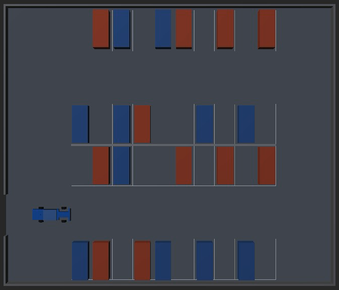
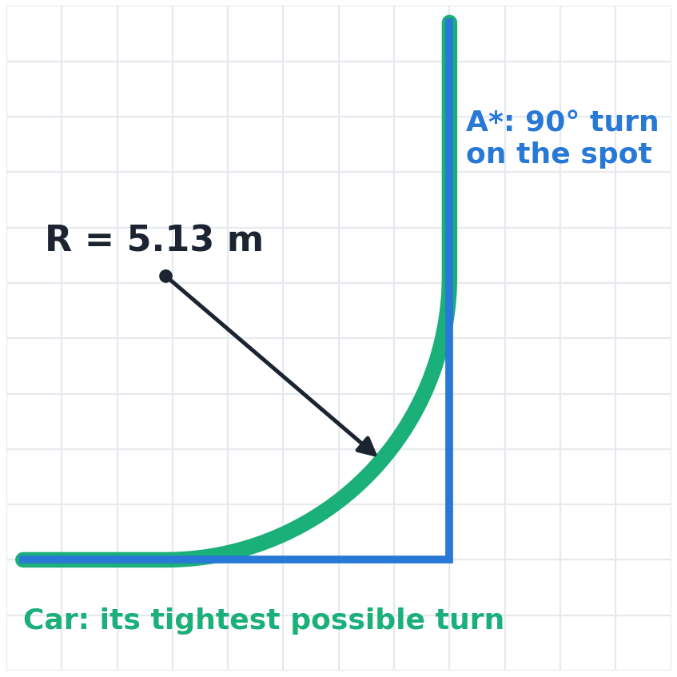
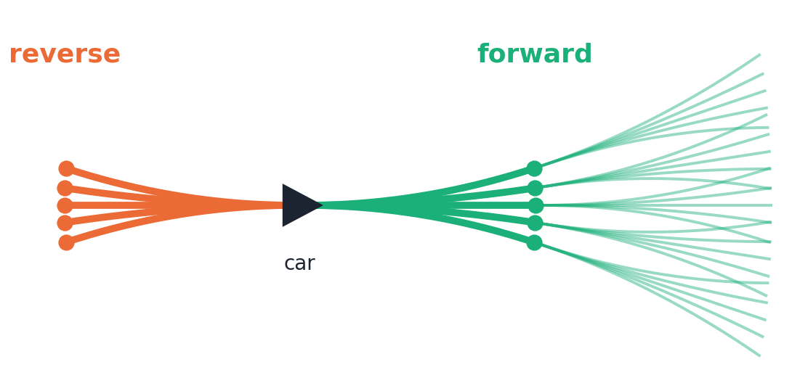

# Autonomous Valet Parking Agent

**Project report**

CSAI4014 Algorithms for Intelligent Systems and Robotics (AISR)
B.Tech CSE (AI & ML), Semester VII

Project P13 · Group G08 · Batch B3

| Member | SAP ID | Module |
|---|---|---|
| Devansh Singh Rawat | 500124378 | M1 – World and Sensors |
| Bhavya Talwar | 500121992 | M2 – Route Planner, integration |
| Harshil Mittal | 500121907 | M3 – Parking Manoeuvres |
| Mohammad Shahvez | 500124132 | M4 – Control and Results |

Submitted to: [course instructor]
Date: [submission date]

Code: https://github.com/bhavyatalwar04/Autonomous-Valet-Parking-Agent

---

# Abstract

This project builds an autonomous valet parking agent: a car-like vehicle with Ackermann steering that enters a parking lot, finds a free bay, drives to it and reverses in. It is simulated in Webots with Python controllers. The agent follows the declarative–procedural–reflexive hierarchy. A deliberative layer chooses a bay and plans a route. A procedural layer runs the parking manoeuvre as a state machine. A reflexive layer stops the car whenever an obstacle comes too close. A control layer steers along the route and holds the speed.

For route planning we compare grid A*, A* with smoothing and Hybrid A*. Over six routes, Hybrid A* was the only method whose routes respected the car's 5.13 m minimum turning radius and cleared its footprint, for 8 % more length and about 0.4 s of planning time. For path tracking we compare pure pursuit and the Stanley controller, with and without curvature feed-forward.

Joining the layers exposed dependencies that tests of single modules did not show. We derive where the planned route must end from the geometry of the parking manoeuvre, make the route end there exactly with a cubic curve, and let a reflexive stop trigger deliberative replanning. In our offline simulation the agent parked in 34 of 40 bays (85 %) with both neighbouring bays occupied and without contact in any run. It also recovered when its chosen bay was taken and when a pedestrian blocked the route. Runs of the full agent in Webots on three bays confirmed the offline results.

**Keywords:** autonomous valet parking, intelligent agents, layered architecture, path planning, A*, Hybrid A*, Ackermann steering, pure pursuit, Stanley controller, Webots.

---

# Contents

- 1. Introduction
  - 1.1 Background
  - 1.2 Problem statement
  - 1.3 Objectives
  - 1.4 Syllabus topics covered
  - 1.5 Scope and assumptions
  - 1.6 Organisation of the report
- 2. System Overview
  - 2.1 Layers and modules
  - 2.2 One control step
  - 2.3 What passes between modules
  - 2.4 Shared conventions
  - 2.5 Offline and in Webots
- 3. Literature Review
  - 3.1 Intelligent agents and layered control
  - 3.2 Path planning on a map
  - 3.3 Planning for a car: kinematic constraints
  - 3.4 Following the route
  - 3.5 Reacting to obstacles
  - 3.6 Simulation
  - 3.7 Gap addressed by this project
- 4. Novelty
  - 4.1 A drivability-focused comparison of three planners
  - 4.2 A pre-park pose derived from the manoeuvre's geometry
  - 4.3 An exact final approach without Reeds–Shepp curves
  - 4.4 Two-stage slot choice
  - 4.5 Reflexive stops that trigger deliberative replanning
  - 4.6 Measured parking success in every bay
  - 4.7 Offline results confirmed in Webots
- 5. World and Sensors (M1)
  - 5.1 The lot
  - 5.2 The car
  - 5.3 Sensors
  - 5.4 Free-slot detection
  - 5.5 What running the world showed
  - 5.6 Limitations
- 6. Route Planner (M2)
  - 6.1 Role in the agent
  - 6.2 The map
  - 6.3 The car model
  - 6.4 Grid A*
  - 6.5 A* with smoothing
  - 6.6 Hybrid A*
  - 6.7 The pre-park pose
  - 6.8 Exact final approach
  - 6.9 Choosing a bay and replanning
  - 6.10 Interface
  - 6.11 Testing
  - 6.12 Limits
- 7. Parking Manoeuvres (M3)
  - 7.1 M3's role
  - 7.2 State machine
  - 7.3 Manoeuvre and safety
  - 7.4 Verification
  - 7.5 Limits
- 8. Control (M4)
  - 8.1 Role in the agent
  - 8.2 Representing the route
  - 8.3 Steering: Pure Pursuit
  - 8.4 Steering: Stanley
  - 8.5 Reversing
  - 8.6 Speed
  - 8.7 Handling noise
  - 8.8 Offline test vehicle
  - 8.9 Testing
  - 8.10 Limits
- 9. Results
  - 9.1 Experimental setup
  - 9.2 Comparison 1: route planners
  - 9.3 Comparison 2: path tracking
  - 9.4 Parking manoeuvre in Webots
  - 9.5 Whole agent: scenarios
  - 9.6 Whole agent: every bay
  - 9.7 Offline against Webots
  - 9.8 Summary
- 10. Contribution
  - 10.1 Bhavya Talwar (M2 – Route Planner and integration)
  - 10.2 Devansh Singh Rawat (M1 – World and Sensors)
  - 10.3 Harshil Mittal (M3 – Parking Manoeuvres)
  - 10.4 Mohammad Shahvez (M4 – Control and Results)
- 11. Conclusion
- 12. Limitations and Future Work
  - 12.1 Limitations
  - 12.2 Future work
- 13. References

---

# 1. Introduction

## 1.1 Background

Parking is a demanding part of everyday driving. The space is tight, the car must reverse, and other cars and people are close by. It is also one of the most suitable driving tasks to automate: speeds are low, the area is small, and its layout is known in advance. In automated valet parking the driver leaves the car at the entrance, and the car finds a free bay and parks itself.

The task is a good test of an intelligent agent because no single method solves it. The car has to *decide* which bay to use and how to reach it, which needs a map and a planner. It has to *carry out* a reverse-parking manoeuvre, which is a fixed procedure. And it has to *react* at once when something comes too close, which leaves no time to plan. These three needs are the declarative, procedural and reflexive levels of our syllabus, and they match the layered architectures used in mobile robotics [2], [3].

Planning for a car is also harder than planning for a point robot. A car cannot turn on the spot, so the shortest path on a grid is usually one it cannot drive. Hybrid A* was developed for this kind of semi-structured space, in the DARPA Urban Challenge [10], [12], and it is the planner our agent uses.

## 1.2 Problem statement

The course brief for project P13 asks for a car-like (Ackermann) vehicle that finds a free slot in a parking lot and parks itself, using a deliberative planner for the route and reactive rules for the close-range manoeuvres.

We made this precise. The lot is 40 m × 34 m with 40 perpendicular bays in four rows. By default 22 bays hold parked cars and 18 are free. The car, 4.6 m long and 1.9 m wide, starts at the entrance. A run succeeds when the car passes the checks M3 applies before it reports that parking is complete, and has hit nothing on the way. That is, when the car:

- is at rest inside a free bay;
- has its body centre within 0.15 m of the bay centre;
- is within 3° of the bay's axis;
- has not touched a wall, the kerb, a parked car or a pedestrian on the way.

The agent must also cope with two changes while it drives: another car taking the bay it chose, and an obstacle appearing on its route.

## 1.3 Objectives

1. Build the parking lot, the car and its sensors in Webots, and detect free bays from the lidar scan (M1).
2. Plan a route from the entrance to a free bay that the car can drive, and compare grid A*, A* with smoothing and Hybrid A* (M2).
3. Reverse into the bay with a state machine, and stop safely when an obstacle is too close (M3).
4. Follow the route and hold the speed, and compare pure pursuit with the Stanley controller (M4).
5. Join the four modules into one agent, and measure how often it parks, in every bay and when the lot changes.

## 1.4 Syllabus topics covered

| Topic | Where it appears |
|---|---|
| Declarative–Procedural–Reflexive hierarchy | The planner (declarative), the parking state machine and path tracker (procedural), and the safety stops (reflexive) |
| Intelligent agents | A goal-based agent with a sense–plan–act loop; sensors, actuators and environment as in Russell and Norvig [1] |
| Path planning | A* on an occupancy grid, path smoothing, Hybrid A* |
| Moving | The kinematic bicycle model, Ackermann steering, pure pursuit, Stanley and PID speed control |

## 1.5 Scope and assumptions

- The work is in simulation: Webots [18], and an offline simulator of our own that runs the same agent code.
- The layout of the lot is known. Which bays are occupied, and any other obstacle, is sensed with the lidar.
- The car's pose comes from GPS and a compass. We do not estimate position from the lidar.
- Bays are perpendicular, and the car reverses in.
- Speeds are low: 1.0 m/s on the route, 0.5 m/s when a route reverses, and 0.45 m/s while parking.
- Parked cars do not move. The pedestrian is an obstacle that appears on the route and later leaves.

## 1.6 Organisation of the report

Section 2 gives an overview of the system and how its modules connect. Section 3 reviews the literature the agent builds on, and Section 4 presents what is new, with the measurements for each point. Sections 5 to 8 describe the four modules: World and Sensors, Route Planner, Parking Manoeuvres and Control. Section 9 gives the experiments and comparisons. Section 10 states who did what. Section 11 concludes, Section 12 lists the limitations and future work, and Section 13 lists the references.


# 2. System Overview

This section shows how the four modules form one agent: what each layer does, what passes between them, and the conventions they share. Sections 5 to 8 then describe each module in detail.

## 2.1 Layers and modules

Each layer of the agent is one module, owned by one member of the group.

| Module | Layer | What it does | Runs |
|---|---|---|---|
| M1 – World and Sensors | Sensing | The Webots lot and car; turns the lidar scan into free bays and obstacles | Every step |
| M2 – Route Planner | Deliberative | Chooses a bay; plans a drivable route to a pose beside it; replans when the lot changes | Once, then on change |
| M3 – Parking Manoeuvres | Procedural and reflexive | State machine for the reverse park; brakes when a gap is too small | Every step |
| M4 – Control and Results | Control | Steers along the route and holds the speed | Every step |

```
        lidar scan, GPS, compass
                  |
   M1  sensing    |   free bays, new obstacles
                  v
   M2  DELIBERATIVE   choose a bay -> Hybrid A* route to the pre-park pose
                  |                         ^
                  v                         |  stop on the route -> replan
   M3  PROCEDURAL     DRIVE -> ALIGN -> PARK -> DONE
       REFLEXIVE      brake if a gap is under 0.15 m or under the stopping distance
                  |
                  v
   M4  CONTROL        steering and speed commands -> wheel and steering motors
```

The deliberative layer is slow and runs rarely; the layers below it run every control step of 32 ms. This is the split described by Gat's three-layer architecture [3] and by the declarative–procedural–reflexive hierarchy of the syllabus.

## 2.2 One control step

A single class, `ValetAgent` (`agent/valet_agent.py`), runs the whole loop: `actuation = agent.step(time, pose, speed, lidar_ranges)`. In each step:

1. **Sense.** The lidar scan is turned into the gap between the car body and the nearest obstacle on each of its four sides. Once a second it is also used to update which bays are occupied and where new obstacles are.
2. **Plan, when needed.** If the car has no route, or the once-a-second check finds the chosen bay taken or the route blocked, M2 plans again from the car's current pose.
3. **Decide.** M3's state machine takes the gaps, the pose and whether the route is complete, and returns a command: follow the route, park with a given speed and steering angle, or stop.
4. **Act.** M4 turns that command into a steering angle and a speed, which the Webots controller sends to the motors.

## 2.3 What passes between modules

| From | To | Data |
|---|---|---|
| M1 | M2 | Occupied bays; obstacles seen by the lidar, as rectangles |
| M1 | M3 | Pose and speed; gaps around the car body |
| M2 | M3 | The chosen bay and its pre-park pose |
| M2 | M4 | The route: poses about 0.25 m apart, each marked forward or reverse |
| M3 | M4 | A command: follow the route, park (speed and steering), or stop |
| M4 | M3 | Whether the route is complete |
| M3 | M2 | An emergency stop on the route, which triggers a new plan |

## 2.4 Shared conventions

Mismatched conventions between modules are a common source of bugs, so all four modules use the same ones:

- **Frame:** Webots' east–north–up frame, with the origin at the lot's bottom-left corner and units of metres and radians.
- **Pose:** the centre of the car's rear axle, which is also the Webots robot's origin and the GPS position.
- **Heading:** measured anticlockwise from the x-axis.
- **Signs:** a positive steering angle turns left, and a positive speed is forward.

Tests check these at the boundaries. For example, `tests/test_m1_world.py` checks the Webots world against the planner's map of the lot, and `tests/test_m4_control.py` checks the steering signs forward and in reverse.

## 2.5 Offline and in Webots

The same `ValetAgent` runs in two places:

- **Webots:** `controllers/valet_agent/valet_agent.py` reads the GPS, compass and lidar, and drives the four wheel motors and two steering motors.
- **Offline:** `agent/run_offline.py` simulates the lot, a ray-cast lidar and the car's motion, and runs the agent many times without Webots. It ran the 40-bay test and the scenarios in Section 9.

Only the source of the sensor readings differs, so the code measured offline is the code that runs in Webots. Section 9 compares the two directly.



*Figure 1: The Webots world from above: four rows of ten bays, parked cars, and our car (blue) at the entrance on the left.*


# 3. Literature Review

This section reviews the work our agent builds on, in the order the agent uses it: how an intelligent agent is organised, how a route is planned on a map, how a route is made drivable for a car, and how the car follows it.

## 3.1 Intelligent agents and layered control

Russell and Norvig define an intelligent agent as something that perceives its environment through sensors and acts on it through actuators. They range agents from simple reflex agents, which map the current percept straight to an action, to goal-based agents, which search for a sequence of actions that reaches a goal [1]. A valet-parking car needs both. It must decide where to go, which is goal-based. It must also react at once when something gets too close, which is reflex.

Brooks argued against one central planner. In his subsumption architecture, simple reactive layers run in parallel, and higher layers can override lower ones [2]. Reactive layers respond quickly and cope well with surprises, but on their own they cannot plan a long route through a parking lot.

Gat's three-layer architecture combines the two ideas [3]. It has a *deliberator* that plans slowly and far ahead, a *sequencer* that runs step-by-step procedures, and a *controller* that reacts within each control cycle. This matches the declarative–procedural–reflexive hierarchy in our syllabus, and it is the structure of our agent:

- the route planner (M2) is the deliberative layer;
- the parking state machine (M3) is the procedural layer, with its safety checks as the reflexive layer;
- the path tracker (M4) is the low-level controller.

## 3.2 Path planning on a map

Hart, Nilsson and Raphael introduced A* [4]. It finds a lowest-cost path in a graph by expanding nodes in order of `f = g + h`. Here `g` is the cost so far and `h` is an estimate of the remaining cost. A* is guaranteed to find an optimal path if `h` never overestimates the remaining cost (an *admissible* heuristic). On an occupancy grid, A* is the standard method for global route planning. LaValle's textbook covers it together with the configuration-space idea: inflate the obstacles by the robot's size so that the robot can be planned for as a point [5]. Our grid A* uses both.

Sampling-based planners are the other main family. Probabilistic roadmaps [6] and RRT* [7] connect random samples of the configuration space and suit high-dimensional problems. For a flat parking lot with a known map, grid and lattice search are simpler and give repeatable results, so we did not use sampling.

## 3.3 Planning for a car: kinematic constraints

A car cannot turn on the spot. With wheelbase `L` and maximum steering angle `δ_max`, its tightest turn has radius `R_min = L / tan(δ_max)`. Dubins found the shortest paths for a car that only drives forward with a bounded turning radius [8]. Reeds and Shepp extended this to a car that can also reverse [9]. Their paths are made of circular arcs and straight lines, and they are widely used as an exact "last step" to a goal pose.

Grid A* ignores the turning radius, so its paths have sharp corners that a car cannot drive. Two fixes are common:

1. **Smooth the path afterwards.** Dolgov *et al.* refine their routes with a numerical optimisation that trades off smoothness, distance from obstacles and curvature [10]; a simpler version, which our project uses for grid A*, pulls each point towards its neighbours. Smoothing rounds corners off, but because curvature is only a penalty in the cost, it does not guarantee the turning radius is respected.
2. **Plan with the car's motion built in.** Pivtoraiko *et al.* search a *state lattice* of pre-computed drivable motions [11]. Dolgov *et al.* proposed **Hybrid A\*** for the Stanford entry in the DARPA Urban Challenge [10], [12]. It keeps a continuous `(x, y, heading)` state, expands it by driving short arcs of the car model, and stores at most one state per cell of a coarse 3D grid. Its heuristic is the larger of two estimates: a 2D distance that goes around obstacles but ignores the turning radius, and a distance that respects the turning radius but ignores obstacles. It finishes with an analytic Reeds–Shepp step to the goal. Hybrid A* was designed for parking lots and other semi-structured spaces, which is exactly our setting.

Paden *et al.* survey these planning methods, the controllers in Section 3.4 and the vehicle models they rely on, for self-driving vehicles [13]. A lesson we draw from this, and saw in our own integration, is that the planner and the controller must use the same vehicle model for a route to be drivable.

## 3.4 Following the route

Pure pursuit steers the car towards a point a fixed "look-ahead" distance along the path, using the arc that passes through that point [14]. It is simple and stable, but cuts corners when the look-ahead is long. The Stanley controller, from the DARPA Grand Challenge winner, steers by the heading error plus a term in the cross-track error measured at the front axle [15], [16]. It tracks more tightly at low speed. A PID loop is the usual way to hold a target speed. Our M4 module compares pure pursuit and Stanley, and the M3 parking manoeuvre uses pure-pursuit geometry when reversing into the bay.

## 3.5 Reacting to obstacles

Local reactive methods keep the car safe between plans. The dynamic window approach picks velocities that the robot can reach within one control step and that keep it clear of obstacles [17]. Our reflexive layer is simpler. It compares each measured gap around the car body with the stopping distance at the current speed, and brakes if the gap is too small. The deliberative layer then plans a new route around the obstacle. This is the layered split described by Gat [3].

## 3.6 Simulation

Webots is a robot simulator with physics, sensor models (lidar, GPS, compass) and a vehicle library for Ackermann cars [18]. Testing in simulation lets us run the same scenario many times and compare methods fairly, which would be costly and unsafe with a real car.

## 3.7 Gap addressed by this project

The papers above each study one layer: a planner, a controller, or an architecture. Course projects usually show a planner on its own. What is less often shown is how the layers depend on each other in a parking task:

- where the global route must end so that the local manoeuvre can succeed;
- how exactly it must end there;
- what the deliberative layer should do after the reflexive layer stops the car.

Our project builds all three layers and measures these links (Section 4).


# 4. Novelty

Each layer of our agent uses a known method: A* and Hybrid A* for planning, a state machine for the parking manoeuvre, and Stanley / pure pursuit for tracking. What is new is how the layers were joined and measured. Building the whole chain showed several dependencies between the global planner and the local manoeuvre that single-layer studies do not show. We solved them with small, explainable additions and measured each one. The full measurements are in Section 9; this section states each contribution and its key result.

## 4.1 A drivability-focused comparison of three planners

We compare grid A*, grid A* with gradient smoothing, and Hybrid A* on the same lot, start and goals. Path length and planning time are the usual measures, but they do not show whether a car can drive a route. We added measures that do:

- maximum curvature, computed separately for each forward and reverse stretch, so a direction change is not counted as a sharp turn;
- the length of route that is tighter than the car can turn;
- how often the car's real rectangular footprint hits an obstacle along the route;
- the heading error at the goal.

These measures change the conclusion. On length and time alone, grid A* wins: its routes are shortest and it is about 40 times faster. On the new measures, none of its routes can be driven as planned. On average 3.3 m of each route is tighter than the car can turn, and the body would hit an obstacle at four poses. Smoothing does not fix this; the too-tight length even rises slightly. Only Hybrid A* has no too-tight stretch and no collision, for 8 % more length (Section 9.2).

## 4.2 A pre-park pose derived from the manoeuvre's geometry

The planner does not drive into the bay. It stops at a "pre-park" pose on the aisle, and the reactive layer reverses in from there. Placing that pose on the aisle centre line seemed natural, but in the integrated run the reverse swing touched the parked car in the next bay. The geometry explains why. The manoeuvre reverses on a quarter circle of radius `R = L / tan(0.85 δ_max) = 6.19 m`, and the neighbouring car lies inside that turn. It must therefore stay within the innermost circle the body sweeps, radius `R − w/2 = 5.24 m`. From the centre line, 3.5 m out from the bay, the neighbour's far corner is exactly 5.24 m from the circle's centre, so the gap is zero. From 4.0 m out it is 0.2 m, and the simulation measured 0.19 m. The pre-park pose is now worked out from the manoeuvre rather than chosen by eye.

## 4.3 An exact final approach without Reeds–Shepp curves

Hybrid A* only promises to reach the goal within 0.5 m, but the geometry above leaves about 0.3 m of room across the aisle. Instead of the usual Reeds–Shepp step [9], [10], we search to a point 5 m before the goal and join it to the exact goal with a cubic curve, checked against the turning limit and for collisions. This works because every pre-park pose lies on a straight aisle, facing along it. It is a few lines of algebra, easy to explain, and every route now ends exactly on the goal (Section 6.8).

## 4.4 Two-stage slot choice

Choosing a slot needs a route cost for every free slot. Hybrid A* takes about a second per slot, so we rank all free slots with fast grid A* (a few ms each) and then run Hybrid A* only on the best one, moving to the next only if it fails. The slot choice takes about one Hybrid A* run instead of one per free slot.

## 4.5 Reflexive stops that trigger deliberative replanning

The three layers interact in a defined way:

- the reflexive layer (M3 safety) stops the car whenever a gap around the body is below its stopping distance;
- once the car is stopped, the deliberative layer (M2) rebuilds the map from the lidar and plans again from where the car is, to the same slot if it is still free, otherwise to the next best;
- if every new route is stopped again before the car can move, the agent reports that it is boxed in rather than looping.

In the offline scenarios the agent parked in every case: in A2 with no replanning, in B0 after another car took its first choice, and in A2 after a pedestrian blocked the route and two replans. It never came closer than 0.20 m to anything (Section 9.5).

## 4.6 Measured parking success in every bay

Rather than one demonstration, we tried to park in each of the 40 bays with both neighbours occupied, the tightest case. That test found the problems behind Sections 4.2 and 4.3, plus two more:

- bays drawn against the outer wall left no room behind a parked car;
- the last bay in a row has no room to set up the manoeuvre when approached towards the end wall.

With all four fixed, the agent parked in 34 of 40 bays (85 %), with no contact in any run; the closest the body came to an obstacle was 0.07 m. The six bays that still fail are at the ends of the aisles, and in each the safety layer stopped the car before contact (Section 9.6).

## 4.7 Offline results confirmed in Webots

The offline runs use our own simulated lidar and a bicycle model of the car, so the same agent was also run in Webots. Webots exposed one problem the offline model could not: with the lidar mounted 0.28 m above the rear axle, it saw the car's own wheels, the map showed obstacles all around the car, and no route could be planned. Raising it to 0.35 m, above the tyres and below the cabin, fixed this.

On the final code, the same run to bay A2 parked at 52.90 s offline and 52.93 s in Webots, with every phase beginning within 0.15 s of the offline time. The car ended about 1 cm further from the bay centre in Webots and 0.3° less straight. This agreement is what supports using the offline 40-bay test as the success rate (Section 9.7).


# 5. World and Sensors (M1)

This section describes the simulated parking lot, the car model and the sensors that the other modules depend on. It also records what went wrong when the world was first run, because the problems changed how we check it.

## 5.1 The lot

The lot is a Webots world (`worlds/parking_lot.wbt`) built to the same numbers as the planner's map (`planner/parking_lot.py`) [18]. It is 40 m × 34 m, with a 5 m gap in the left wall at y = 6–11 m as the entrance. There are 40 bays, A0–D9, each 2.5 m wide and 5 m deep, in four rows. Rows B and C sit back to back on an island with a 0.24 m kerb, so a car cannot cut across it. Rows A and D stand 0.5 m in from the lot boundary, 0.25 m clear of the wall's inner face. This matters for the sensor: a 4.5 m car centred in a 5 m bay that starts at the wall would have its rear on the wall's inner face, and a lidar return from the wall could not be told from a return from the car. Twenty-two bays hold parked cars, the same set the planner uses as its default.

World and planner must describe the same lot, so `tests/test_m1_world.py` reads the world file and checks every bay line, every row edge and every parked car against `planner/parking_lot.py`.

## 5.2 The car

The car is a dynamic four-wheel Ackermann vehicle, 4.6 m × 1.9 m, with a 2.8 m wheelbase and a 1.6 m track. Pose is the centre of the rear axle, the same reference M2, M3 and M4 use. All four wheels have a motor and the front pair steers, within ±0.65 rad. At the planner's largest bicycle angle of 0.5 rad the inner front wheel needs 0.57 rad, so the limit leaves room. M1 itself never drives the car. M4 owns the motors; M1 provides a throw-away bring-up controller, `m1_actuator_check`, that checks the signs once.

## 5.3 Sensors

| Sensor | Use |
|---|---|
| GPS, compass, IMU | Rear-axle position and heading (counter-clockwise from +x) |
| 360° planar lidar, 721 rays, 40 m | Slot occupancy and body clearances. The scan plane is 0.65 m above the floor, so it hits walls and parked cars but not the kerb or the paint lines |
| Four distance sensors (front, rear, left, right) | Near-field cross-check; logged raw, not yet calibrated |
| Steering and wheel position sensors | Steering angle and wheel odometry |

Three conventions had to be fixed before the readings were usable. Webots returns a lidar image clockwise, so it is reversed before use. The compass returns world north in the robot's frame, so heading is `atan2(north_x, north_y)`. The lidar needs no rotation, because Webots devices already use a forward–left–up frame.

## 5.4 Free-slot detection

For each bay the detector casts every lidar ray against the bay's footprint. A return inside the parked-car footprint, padded by 0.2 m, marks the bay *occupied*. A ray that crosses the bay and lands beyond it shows the bay is visible and empty, so the bay is *free*. A bay that no ray reaches stays *unknown*. It is never assumed free, because a wrong "free" sends the car to a bay that is taken.

Wall-backed bays exposed a flaw. The test accepted a return up to 0.2 m beyond the padded footprint, so a wall just behind an empty bay could mark it occupied. A parked car never reaches past its bay's back line, so the detector now counts only returns that land inside the bay itself.

## 5.5 What running the world showed

We ran the world in Webots R2023b, headless, and checked it three ways.

1. **Actuators.** `m1_actuator_check` passed 5 of 5. Driving forward moved the car 2.82 m (expected about 3), a left command turned it +24.0° against +25.3° from the bicycle model, the steering sensors matched the command to three decimals (0.327 and 0.277 rad), and reversing moved it −2.79 m.
2. **Slot detection with the real lidar.** From the entrance pose (2.0, 8.5), over 167 one-second reports the controller classified 13 bays occupied, 11 free and 16 unknown. It never called a free bay occupied or an occupied bay free. Row A, directly in front of the car, was resolved completely: A0, A1, A3, A4, A6 and A8 occupied, A2, A5, A7 and A9 free. The unknown bays are the ones no ray reached from that pose, which is the intended behaviour for a single scan.
3. **Without a simulator.** `tests/test_m1_world_scan.py` ray-casts a 721-ray scan against the world file's walls and cars and checks what the detector reports from the aisle in front of each parked car and each free wall-side bay. The tests run in CI, where Webots is not available.

The first run did not pass. Three faults in the world came to light:

- **Missing ground.** The world had no `EXTERNPROTO` declarations, so Webots R2023b skipped the floor and the background when it loaded the file. With no ground, the car fell, and the actuator check passed only 2 of 5 (the "straight keeps heading" and "steering sensors" checks passed because they do not need movement). Declaring the three prototypes fixed it.
- **Cars lying across their bays.** Each of the 22 parked-car boxes was 4.5 m wide in x, in a bay 2.5 m wide. Six pairs of neighbouring cars overlapped by 2 m, and their boxes covered the free bays between them, so even a correct detector would have seen those bays as occupied. Rotating each car a quarter turn fixed it. The ray-cast tests fail on the original file.
- **Rows against the wall.** Moving rows A and D 0.5 m off the wall, as in the planner, removed the wall from the bays' footprints.

None of these shows up in a unit test of the detector alone. Each was found by running the world, or by checking it against the planner's map, which is why the world-file tests exist.

## 5.6 Limitations

- The Webots runs used software rendering and fast mode, not real time. The actuator figures are from one run on one machine.
- One scan from the entrance leaves 16 of 40 bays unknown. The car must move to a better viewpoint, or combine scans, before it chooses a slot. A "free" reading comes from a ray that crosses the padded footprint, so a ray that only clips a corner of an occupied bay's padding can still call it free. We saw this once in the ray-cast checks (B5, from the far aisle across the island) and did not change it. From the aisle in front of the bay, which is where the car parks from, every bay the tests check was classified correctly.
- Tyre friction, motor torque and suspension are not calibrated. The distance sensors are not converted to metres.


# 6. Route Planner (M2)

This section describes the deliberative layer of the agent: how it represents the lot, chooses a free bay and plans a route the car can actually drive. The measured comparison of the planners is in Section 4 and `results/planner_comparison.md`.

## 6.1 Role in the agent

The planner answers two questions: *which free bay should the car go to*, and *how does it get there*. It is slow compared with the control loop (up to about a second per plan), so it runs once at the start and again only when something changes. It does not drive the car into the bay. Its route ends at a **pre-park pose** on the aisle, and the parking manoeuvre (M3) reverses in from there.

| Input | From |
|---|---|
| Which bays are occupied | M1 free-slot detection |
| Current pose (x, y, heading) of the rear axle | M1 GPS and compass |
| Extra obstacles seen by the lidar (for example a pedestrian) | M1 lidar scan |

| Output | Used by |
|---|---|
| Chosen bay and its pre-park pose | M3 |
| Route: poses about 0.25 m apart, each marked forward or reverse | M4 path tracking |

## 6.2 The map

The lot is an occupancy grid with 0.25 m cells (`planner/grid_map.py`, `planner/parking_lot.py`): 160 × 136 cells for the 40 m × 34 m lot. A cell is either free or occupied. Walls, the kerb between rows B and C, and the parked cars are drawn in as rectangles. The grid uses the same frame as Webots (x and y on the ground, origin at the lot's bottom-left corner), so a pose from the GPS can be used without conversion. An occupancy grid suits this problem because the lot is small, flat and mostly static, and both A* and Hybrid A* work directly on it [5].

## 6.3 The car model

The planner uses the kinematic bicycle model, with the pose taken at the centre of the rear axle. Driving a distance `d` with steering angle `δ` changes the heading by `d · tan(δ) / L`, where `L = 2.8 m` is the wheelbase. With the steering limit `δ_max = 0.5 rad`, the tightest circle the car can drive has radius

`R_min = L / tan(δ_max) = 5.13 m`,

so no drivable route can bend more sharply than `1 / R_min = 0.195 m⁻¹`.

For collision checks, the 4.6 m × 1.9 m body is covered by three circles of radius 1.32 m along its centre line (`planner/vehicle.py`). The obstacles are grown by that radius once, when the map is built. Checking a pose is then three cell look-ups, which matters because Hybrid A* checks hundreds of thousands of poses per plan. The circles overhang the corners of the body slightly, so the check errs on the safe side.

## 6.4 Grid A*

A* searches the grid cell by cell, always expanding the cell with the lowest `f = g + h`, where `g` is the distance travelled so far and `h` is an estimate of the distance left [4] (`planner/astar.py`). We use 8-connected moves (cost 1 straight, √2 diagonal) and the octile distance as the heuristic. Octile distance is the exact cost on an empty 8-connected grid, so it never overestimates, and A* returns the shortest grid path. Diagonal moves that would cut the corner of an obstacle are not allowed.

A* treats the car as a disc centred on the rear axle and has no notion of heading. Its paths turn 45° or 90° on the spot, which a car cannot do. We keep it for two reasons: as the baseline in the comparison, and as a fast way to estimate route lengths when choosing a bay.



*Figure 2: A grid A* route turns 90° on the spot (blue). The car's tightest possible turn is a circle of radius 5.13 m (green), so it cannot follow the A* corner.*

## 6.5 A* with smoothing

The second method smooths the A* path by gradient descent (`planner/smoothing.py`). Each interior point is pulled towards its original position and towards the midpoint of its neighbours, and a move that would enter an obstacle is undone. This rounds the corners, but it gives no guarantee about the turning radius: Section 4 shows the smoothed paths still contain stretches tighter than the car can turn.

## 6.6 Hybrid A*

Hybrid A* [10] searches over car poses `(x, y, heading)` instead of cells (`planner/hybrid_astar.py`). Our implementation works as follows.

- **Motion primitives.** From each pose the search drives the bicycle model 1 m with one of five steering angles (full left, half left, straight, half right, full right), forward or in reverse. That gives ten successors per pose. Every route is a chain of these arcs, so it respects the turning radius by construction.
- **Binning.** Poses are continuous, so they are grouped into bins of 0.5 m × 0.5 m × 5°. Only one pose is expanded per bin. This keeps the search finite while the poses themselves stay exact.
- **Cost.** The cost of a step is its length, multiplied by 2 in reverse, plus small penalties for steering, for changing the steering angle, and a penalty of 5 for each switch between forward and reverse. The planner therefore prefers calm forward driving and reverses only where it must.
- **Heuristic.** Before the search, one Dijkstra pass from the goal gives every cell its shortest obstacle-free distance to the goal. This guides the search along the aisles and round the island instead of into walls.
- **Collision checks.** Each arc is checked every 0.25 m with the three-circle model.
- **Stopping.** The search stops when a pose is within 0.5 m and 10° of the goal, or reports failure after 100 000 expansions.



*Figure 3: Hybrid A* motion primitives (schematic). From the car's pose the search drives five steering angles forward (green) and in reverse (orange); the paler arcs show the next level of the search tree.*

Compared with the original paper we made three simplifications. We do not use the Reeds–Shepp heuristic [9], only the obstacle-aware one. We do not use an analytic Reeds–Shepp connection to the goal; a simpler curve does that job (below). And we do not post-optimise the route.

## 6.7 The pre-park pose

M3 reverses into a bay on a quarter circle of radius 6.19 m. The pre-park pose is where the planner hands over, so it must leave room for that arc. It is placed 4 m out from the bay's entrance line and 3 m past the bay along the aisle, facing along the aisle (`pre_park_poses`). Each bay has two such poses, one for each direction of approach. The planner also checks that there is room for M3's forward set-up move, about 6.5 m beyond the bay; if that would run into the end wall, it uses the other direction. Section 4.2 gives the geometry behind the 4 m.

## 6.8 Exact final approach

The 0.5 m goal tolerance of Hybrid A* is too loose for the hand-over: the room for error across the aisle is about 0.3 m. With `final_approach_m = 5`, the search instead ends at a point 5 m before the pre-park pose, on the same line, and a cubic curve joins the two (`planner/final_approach.py`). In the goal's frame, with `u` along the aisle and `v` across it, the curve is

`v(t) = v₀ + m₀ t + a t² + b t³`, with `a = −(3v₀ + 2m₀D) / D²` and `b = (2v₀ + m₀D) / D³`,

where `v₀` and `m₀` are the sideways offset and slope at the end of the searched route and `D` is the distance left. It ends exactly on the goal with zero offset and zero slope. Every point of the curve is checked against the curvature limit and for collisions. If either check fails, the search continues to another candidate.

## 6.9 Choosing a bay and replanning

Choosing a bay needs a route cost for each free bay. Running Hybrid A* for all of them would take many seconds, so the choice has two stages (`planner/replanning.py`). Grid A* first ranks every free bay by route length, at a few milliseconds each. Hybrid A* then plans to the best one, and moves down the list only if no drivable route exists.

While the car drives, the route is checked once a second against the latest scan. Three events lead to a new plan:

| Event | Response |
|---|---|
| The chosen bay has been taken | Choose a new bay from the car's current pose |
| An obstacle blocks the route ahead | New route to the same bay, or a new bay if it cannot be reached |
| The safety layer stopped the car | Replan from where it stands |

If nothing can be planned, for example while a pedestrian stands in the aisle, the agent waits and tries again after 5 s. In the integrated agent, routes are planned with a 0.4 m safety margin around the body circles to absorb tracking error. If the car has stopped somewhere too tight for that, one more attempt is made with no margin.

## 6.10 Interface

The other modules call two functions. `plan_to_slot(grid_map, start_pose, slot)` returns the route, statistics (including the forward/reverse flag for every pose) and the pre-park pose used. `choose_slot` and `replan` wrap it for the integrated agent. All three planning methods return the same format, so the comparison in Section 4 runs them through the same code path.

## 6.11 Testing

The planner runs in plain Python without Webots. Sixty unit tests cover the grid, A*, Hybrid A*, the final approach, bay choice and replanning (`tests/`). Among other things they check that every Hybrid A* route stays within the curvature limit, clears the body's footprint and ends at the goal. They run on every pull request in GitHub Actions. `python -m planner.compare_planners` regenerates the comparison tables and figures.

## 6.12 Limits

- Planning takes up to about 1.3 s for the farthest bays, so the car plans while standing still.
- The route has constant-curvature arcs, so the steering angle jumps between them. M4's tracking absorbs this at parking-lot speeds.
- The map assumes the lot's layout is known. Only occupancy and extra obstacles come from the sensors.
- Six bays at the aisle ends cannot yet be parked in (Section 4.6). Reaching them needs multi-point turns in tight space.


# 7. Parking Manoeuvres (M3)

**Module owner:** Harshil Mittal  
**Project:** Autonomous Valet Parking Agent

This section describes the local parking behaviour, how it hands control to M4, and what the integrated controller did in the latest-main Webots run.

## 7.1 M3's role

M3 handles the final perpendicular reverse-parking manoeuvre. M1 supplies the car pose, signed speed and body clearances. M2 supplies the selected bay and route to its pre-parking pose. M3 asks M4 to follow that route, then requests low-speed steering and motion for the final parking manoeuvre. M4 is the only module that sends commands to the Webots motors.

The shared pose is measured at the centre of the rear axle. Heading is in radians, counter-clockwise from world +x; speed is positive forward and negative in reverse.

## 7.2 State machine

The integrated run follows **SEARCH → DRIVE → ALIGN → PARK → DONE**.

| State | Behaviour |
|---|---|
| **SEARCH** | Wait stopped while M1 identifies free bays and M2 selects a reachable bay and plans its route. |
| **DRIVE** | Ask M4 to follow the M2 route, including its forward/reverse direction flags. M3 waits for route completion and a full stop before continuing. |
| **ALIGN** | Move forward to the turning pose beside the target bay, then stop and confirm the setup pose. |
| **PARK** | Reverse along a feedback-controlled quarter-circle and straight segment. If alignment needs correction, stop first and use one of at most two bounded correction attempts. |
| **DONE** | Hold stopped after checking speed, heading, bay-centre position and the full vehicle footprint. |
| **EMERGENCY_STOP / FAILED** | Brake and latch the stop after an unsafe clearance, invalid or stale sensor input, timeout, unsupported geometry or failed manoeuvre. |

M3 returns explicit **FOLLOW_ROUTE**, **PARKING** or **STOP** commands. M4 follows the route for FOLLOW_ROUTE, applies M3's signed speed and steering requests for PARKING, and holds the vehicle for STOP. A direction change is not issued until the car has stopped.

## 7.3 Manoeuvre and safety

The reverse-in path uses feedback from the measured pose. M3 calculates the desired rear-axle target from the bay centre and vehicle geometry, moves forward to a feasible turning pose, reverses through the turn, and straightens inside the bay. The selected settings are 0.45 m/s parking speed and 0.55 m lookahead; the parameter comparisons and earlier A2, B0 and A5 trials are documented in [M3 Webots tuning](../m3_webots_tuning.md).

The safety layer rejects stale sensor snapshots (older than 0.2 s), missing or non-finite pose, speed or clearances, and clearances below 0.15 m. It also checks the speed-dependent stopping distance using a 0.2 s reaction time and the configured 1 m/s² braking deceleration. Parking speed is limited to 0.5 m/s and bicycle steering to the vehicle's 0.5 rad limit. DONE requires the car to be stopped below 0.03 m/s, within 3° of the bay heading and within 0.15 m of the bay centre, with its corners inside the bay.

## 7.4 Verification

The existing test file tests/test_parking.py covers state transitions, route handoff, direction changes, stale or invalid sensors, emergency stops, parking completion, slow steering response, obstacle interruption and bounded corrections. The latest-main GitHub Actions checks visible at the time of this run completed successfully for the module tests, M2 planner tests and parking tests.

On 16 November 2026, I ran the integrated agent in Webots R2025b Nightly from the latest-main source snapshot, commit 673f7c205ef2b29ef11d3999909715023dfd58dd. The fresh run began at rear-axle pose (2.00, 8.50, 0°). The car selected A2, completed the route, aligned, reverse-parked and reported DONE: Parking completed at 52.93 simulated seconds. M3's ALIGN-to-DONE interval was 36.67 simulated seconds. The final logged rear-axle pose was (14.25, 1.76) with heading 90° (rounded in the Webots console).

| Latest-main Webots check | Result |
|---|---|
| Target selected by M1/M2 | A2 |
| Route-planning time | 1.22 s |
| ALIGN began | 16.26 s |
| PARK began | 25.54 s |
| DONE | 52.93 s |
| Final state | DONE — Parking completed |


*Figure 4: Webots overhead view after the latest-main A2 run*

The snapshot's world file still named valet_controller, the sensor-only controller. For this run I used a separate, disposable copy of that exact snapshot and changed only the car's controller field to valet_agent. The GitHub repository was not changed. Devansh's one-word world-file update is still needed for a fresh clone to start the integrated agent when Run is pressed.

## 7.5 Limits

This was one full integrated run on A2. The additional A2, B0 and A5 measurements in the tuning report are earlier controlled M3 trials on their documented base revision; they are useful tuning evidence, but they are not additional runs on the latest-main snapshot. I did not run a pedestrian case in Webots during this check. The run used simulated sensors and the Webots vehicle model; contact sensing was not instrumented, so a successful DONE state is not an independent measurement of contact-free motion.


# 8. Control (M4)

**Module owner:** Mohammad Shahvez (code in `m4_control/`)
**Section written by:** Bhavya Talwar

This section describes the control layer: how the car follows the planned route, holds its speed, and carries out the parking manoeuvre's requests. The experiments that compare the controllers are in the Results section.

## 8.1 Role in the agent

M4 is the only module that commands the car's motion. Every control step it receives a command from M3 and the car's pose and speed, and it returns a steering angle and a speed or acceleration (`M4Controller.step` in `m4_control/m4_controller.py`). It has three modes, chosen by M3:

| Mode | What M4 does |
|---|---|
| `FOLLOW_ROUTE` | Tracks M2's route with a steering controller and a speed profile |
| `PARKING` | Applies M3's requested speed and steering angle, with the speed held by the PID loop |
| `STOP` | Brakes to a standstill and holds; a hard brake for an emergency stop or a failure |

All poses are taken at the centre of the rear axle, heading is measured anticlockwise, and a positive steering angle turns left. These are the same conventions as M1, M2 and M3, which matters because a sign mismatch between modules is the most common integration bug.

## 8.2 Representing the route

The route from M2 is a list of poses, each marked forward or reverse. M4 splits it into segments at every change of direction, because each segment is driven in one gear (`m4_control/path.py`). Each segment is resampled to points 5 cm apart. Its heading and curvature at every point are computed from the points, and the curvature is smoothed over 0.5 m. A short straight extension is added to the end of each segment so that a look-ahead point never runs off the end of the path.

For a route from grid A*, which has sharp corners, `fillet_polyline` replaces each corner with a circular arc of a chosen radius. That made it possible to track A* routes in the experiments as well as Hybrid A* routes.

## 8.3 Steering: Pure Pursuit

Pure Pursuit [14] picks a target point on the path a look-ahead distance `l_d` ahead of the rear axle, and steers along the circular arc that passes through it:

`δ = atan(2 L sin α / l_d)`

Here `L` is the wheelbase and `α` is the angle between the car's heading and the line to the target point. The look-ahead grows with speed, `l_d = 0.6 |v| + 1.2 m`, limited to between 1.2 m and 4 m. A longer look-ahead gives smoother steering but cuts corners; a shorter one tracks tightly but reacts more to noise.

## 8.4 Steering: Stanley

The Stanley controller [15], [16] steers by the heading error plus a term that grows with the sideways (cross-track) error `e`:

`δ = ψ_e + atan(k e / (k_s + |v|))`

with gain `k = 1.5` and a softening constant `k_s = 0.5` m/s that keeps the term bounded at low speed. Going forward, the error is measured at the front axle, as in the original controller.

## 8.5 Reversing

A car reversing behaves like a car driving forward with its heading turned by 180° and its steering angle mirrored. Both controllers use this: when the segment is driven in reverse, M4 applies the forward law to this "virtual car" and flips the sign of the result (`m4_control/lateral.py`).

This exposed a weakness in plain Stanley. When reversing, its reference point is the rear axle, and on a steady arc the heading error there is close to zero, so nothing supplies the steering angle the arc needs. The car drifts outwards until the cross-track error is large enough to correct it. The fix is **curvature feed-forward**: when reversing, add the steering angle that the path's curvature `κ` needs, `atan(L κ)`. Going forward it is not added, because the front-axle reference already carries the curvature through the heading error and adding it would count it twice. The integrated agent uses Stanley with feed-forward.

## 8.6 Speed

The target speed at each point is the lowest of three limits (`m4_control/follower.py`):

| Limit | Formula | Purpose |
|---|---|---|
| Cruise | 1.0 m/s forward, 0.5 m/s reverse (in the agent) | Speed on the route |
| Curve | `sqrt(a_lat / κ)`, with `a_lat` = 1 m/s² | Slow down for bends |
| Stopping | `sqrt(2 a_dec d)`, with `a_dec` = 1 m/s² | Arrive at the end of a segment at rest |

The target is ramped up and down at a limited rate, and a PID controller drives the measured speed towards it. The PID has three refinements:

- its derivative is low-pass filtered, so it does not amplify noise;
- integration pauses while the output is saturated in the same direction, so the integral does not "wind up" and cause overshoot;
- the planned acceleration is added to its output as a feed-forward term.

The final gains are `k_p = 1.5`, `k_i = 0.8` and `k_d = 0`. The output is limited to 2 m/s² of acceleration and 4 m/s² of braking.

At each change of gear the follower stops, waits 0.8 s while the wheels turn to the next segment's steering angle, and then sets off in the new direction. When the last segment is finished it reports that the route is complete, which is M3's signal to start the parking manoeuvre.

## 8.7 Handling noise

`PoseFilter` (`m4_control/estimator.py`) is an optional complementary filter. Each step it predicts the pose from the bicycle model and the last steering command, then moves it 10 % of the way towards the GPS and compass measurement. It smooths noisy positions without adding a long delay.

## 8.8 Offline test vehicle

For experiments without Webots, `m4_control/sim.py` simulates the car with the kinematic bicycle model plus the effects that matter when comparing controllers:

- steering that is limited, rate-limited to 1 rad/s and lags by 0.12 s;
- acceleration that lags by 0.25 s, with drag;
- Gaussian noise on GPS, compass and speed.

## 8.9 Testing

`tests/test_m4_control.py` holds 27 unit tests. They cover:

- the PID controller, including anti-windup;
- path handling and splitting at gear changes;
- the sign conventions of both steering controllers, forward and in reverse;
- that feed-forward acts only in reverse;
- the pose filter;
- the emergency stop;
- the three modes of the M4 controller.

Two of the tests re-run the main controller comparison and check its result: Pure Pursuit and Stanley with feed-forward park, while plain Stanley fails in reverse. The tests were checked by deliberately breaking the controllers, for example by reversing a sign or removing the feed-forward. Each fault made at least one test fail.

## 8.10 Limits

- The controllers are geometric and assume the kinematic bicycle model. They ignore tyre slip, which is acceptable at parking speeds.
- The gains were tuned in the offline simulator. In Webots, M3's parking speed and look-ahead were re-tuned on three bays (Results), but the route-following gains were not.
- Pure Pursuit and Stanley were compared offline only; the Webots runs used Stanley with feed-forward.


# 9. Results

**Section written by:** Bhavya Talwar, from each module's experiments.

This section gathers the measurements from all four modules. It answers four questions:

1. Which planner gives routes the car can drive?
2. Which steering controller tracks those routes best?
3. Does the whole agent park, and does it cope when the lot changes?
4. Do the offline results hold in Webots?

Section 4 explains why some of these results are new; here they are presented in full.

## 9.1 Experimental setup

Two simulators were used.

- **Offline simulator** (`agent/sim_world.py`, `m4_control/sim.py`):
  - the same lot as the Webots world, with a ray-cast lidar of 721 rays;
  - the car modelled as a kinematic bicycle;
  - it runs the same agent code as Webots, so many runs are cheap: one run per bay, controller sweeps over many settings, and repeated noisy runs.
- **Webots R2025b**, with the world `worlds/parking_lot.wbt` and the integrated controller `controllers/valet_agent`. Here M1 detects bays from the simulated lidar and M4 drives the four wheel and two steering motors.

All runs start at the lot entrance, rear axle at (2.0, 8.5) m, facing +x. Unless stated otherwise, 22 bays are occupied, as in the default lot. A run counts as parked when M3's checks pass: stopped, within 0.15 m of the bay centre, within 3° of the bay's axis, and with the whole body inside the bay.

## 9.2 Comparison 1: route planners

Three planners were run from the entrance to the pre-park pose of six bays, one or two in each row (`python -m planner.compare_planners`, `results/planner_comparison.md`).

| Method | Length (m) | Time (ms) | Max curvature, worst route (1/m) | Too-tight length (m) | Footprint hits | Goal heading error (°) |
|---|---|---|---|---|---|---|
| A* | 28.7 | 9.9 | 2.53 | 3.27 | 4.0 | 52.5 |
| A* + smoothing | 28.0 | 21.6 | 1.06 | 3.46 | 1.8 | 44.7 |
| Hybrid A* | 31.0 | 372.9 | 0.20 | 0.00 | 0.0 | 3.4 |

*Mean of six routes, except maximum curvature, which is the worst route. "Too-tight length" is route length with curvature above the car's limit of 0.195 m⁻¹. "Footprint hits" counts route poses where the car's rectangle overlaps an obstacle.*

Grid A* is the shortest and the fastest, but none of its routes can be driven as planned. On average 3.3 m of each route is tighter than the car can turn, the body would hit an obstacle at four poses, and the route ends 52° off the heading the parking manoeuvre needs. Smoothing reduces the curvature peak and the collisions, but because it does not model the turning radius, the too-tight length rises slightly. Hybrid A* has no stretch tighter than the car's limit and no collision, and ends within 3.4° of the required heading. It costs 8 % more length and about 0.4 s of planning, up to 1.3 s for the farthest bay (C9).


*Figure 5: The three planners' routes from the entrance to bay C4. Red crosses mark poses where the car body would hit a parked car; the dashed part of the Hybrid A* route is driven in reverse.*


*Figure 6: Planner comparison over the six routes: length, planning time, worst curvature, length too tight to drive, footprint collisions and final heading error.*

## 9.3 Comparison 2: path tracking

All tracking experiments use M4's offline vehicle model, which includes steering lag and rate limits, on three synthetic routes that end with a reverse park (`python -m m4_control.run_experiments`, `results/m4/tables.md`):

- **straight:** along an aisle, then reverse in;
- **L-route:** two filleted corners, then reverse in;
- **tight:** like straight, but with a reverse arc close to the minimum radius.

The car starts 0.3 m and 0.05 rad off the route. Tracking error is the true cross-track error at the rear axle for every controller, so the comparison is fair. A run counts as parked when the final pose is within 20 cm sideways, 30 cm along the bay and 3°.

### 9.3.1 E1: controller comparison

| Controller (L-route) | RMS error forward (m) | RMS error reverse (m) | Final sideways error (cm) | Final heading error (°) | Parked |
|---|---|---|---|---|---|
| Pure Pursuit | 0.096 | 0.023 | 0.8 | 0.65 | Yes |
| Stanley | 0.365 | 0.420 | 14.7 | 3.61 | No |
| Stanley + FF | 0.365 | 0.018 | 1.4 | 0.65 | Yes |

The straight and tight routes give the same pattern (`results/m4/tables.md`).

Pure Pursuit tracks well in both directions on every route. Plain Stanley tracks forward but fails every reverse park, by 13 to 24 cm sideways and 3.6 to 7.7°. With curvature feed-forward, Stanley's reverse error falls to 1.2–1.8 cm and every run parks. Forward, Stanley's larger error on the L-route comes from the front-axle reference: the rear axle cuts inside the filleted corners.


*Figure 7: Paths driven by the three controllers on the straight, L-shaped and tight routes. Plain Stanley (orange) ends outside the bay after reversing.*

### 9.3.2 E2: tuning sweeps

Six noisy runs per setting, on the L-route, with 5 cm of GPS noise:

- **Pure Pursuit look-ahead:** raising the minimum look-ahead from 0.5 m to 3 m lowers the steering rate from 0.50 to 0.15 rad/s, so the steering is smoother. But the route is cut more, and the final sideways error rises from 0.3 cm to 18 cm. All settings parked.
- **Stanley + FF gain `k`:** between 0.3 and 3 all runs parked, with the final error lowest at `k` = 3 (0.7 cm). At `k` = 5 only 83 % parked, and at `k` = 8 none did, because the steering oscillates.

The defaults (look-ahead 1.2 m, `k` = 1.5) sit inside the safe range on both sweeps.


*Figure 8: Parameter sweeps on the L-route with 5 cm of GPS noise: tracking error, steering activity and parking success against Pure Pursuit's minimum look-ahead (top) and the Stanley + FF gain (bottom).*

### 9.3.3 E3: speed control

A 0 → 2 m/s step response:

| Variant | Rise time (s) | Overshoot (%) | Steady-state error (m/s) |
|---|---|---|---|
| P only | 1.74 | 0 | 0.18 |
| PI | 1.38 | 5.8 | −0.01 |
| PID | 1.44 | 8.4 | −0.03 |
| PI aggressive | 1.20 | 5.3 | 0.00 |

P alone leaves a steady error because of drag; the integral term removes it. The derivative term added overshoot without a benefit, so `k_d` = 0. In a full parking run (ten noisy runs), the acceleration **feed-forward** mattered most:

| Speed controller | Final error along the bay (cm) | Parked |
|---|---|---|
| PI + feed-forward (default) | 0.6 | 100 % |
| PI, no feed-forward | 38.9 | 0 % |
| P + feed-forward | 2.7 | 100 % |

Without feed-forward, the car lagged its speed profile and stopped 39 cm short of its target every time.


*Figure 9: Speed controller step responses for the P, PI and PID variants.*

### 9.3.4 E4: noise

Twenty runs per cell on the L-route, with increasing GPS noise:

| GPS noise σ (m) | Pure Pursuit | Pure Pursuit + filter | Stanley + FF | Stanley + FF + filter | Stanley |
|---|---|---|---|---|---|
| 0 | 100 % | 100 % | 100 % | 100 % | 0 % |
| 0.1 | 100 % | 100 % | 100 % | 100 % | 15 % |
| 0.2 | 90 % | 100 % | 95 % | 100 % | 0 % |

*Share of runs that parked.*

Up to 10 cm of noise neither good controller is affected. At 20 cm, the final error along the bay grows to about 19 cm without the pose filter, and 5–10 % of runs miss the bay. The filter brings the error back to about 3 cm and every run parks.


*Figure 10: Tracking error, final errors and parking success against GPS noise. Dashed lines use the pose filter.*

### 9.3.5 E5: reverse speed

On the L-route without noise, Pure Pursuit and Stanley + FF parked at every reverse speed from 0.5 to 2.5 m/s, though the final error grew with speed (Stanley + FF: 0.1 cm at 0.5 m/s, 10 cm at 2.5 m/s). Plain Stanley parked only at 0.75 m/s or slower. The agent reverses at 0.5 m/s.


*Figure 11: Largest tracking error while reversing, and final heading error, against reverse speed.*

## 9.4 Parking manoeuvre in Webots

M3's parking speed and look-ahead were tuned in Webots, starting from the entrance each time, on bays A2, B0 and A5 (`docs/m3_webots_tuning.md`, `results/m3_webots_tuning/`). Parking time is measured from the start of ALIGN to DONE.

| Bay | Parking time, old → tuned (s) | Centre error, old → tuned (cm) | Heading error, old → tuned (°) | Closest lidar gap, tuned (m) |
|---|---|---|---|---|
| A2 | 45.2 → 36.7 | 6.3 → 5.9 | 0.76 → 0.40 | 0.18 |
| B0 | 46.0 → 37.2 | 6.3 → 6.0 | 0.74 → 0.36 | 0.21 |
| A5 | 45.2 → 36.7 | 6.3 → 5.9 | 0.78 → 0.40 | 0.20 |

*Old settings: 0.35 m/s, look-ahead 0.65 m. Tuned settings: 0.45 m/s, look-ahead 0.55 m.*

All five validation runs with the tuned settings parked. The time fell by about 19 % and the heading error by about half.

## 9.5 Whole agent: scenarios

Three offline scenarios with the full agent (`python -m agent.run_offline`, `results/agent/agent_scenarios.md`):

| Scenario | Result | Time (s) | Replans | Closest gap (m) | Centre error (cm) | Heading error (°) |
|---|---|---|---|---|---|---|
| Normal | Parked in A2 | 52.9 | 0 | 0.20 | 5.0 | 0.08 |
| Another car takes the chosen bay after 3 s | Parked in B0 | 55.0 | 1 | 0.21 | 5.2 | 0.07 |
| A pedestrian steps onto the route 6 m ahead and leaves 10 s later | Parked in A2 | 78.3 | 2 | 0.23 | 5.0 | 0.05 |

In the second case the agent saw the bay become occupied on its next check, stopped and replanned to the next best bay. In the third, the safety layer stopped the car; the agent then replanned twice and waited until the way was clear.


*Figure 12: The pedestrian scenario. Dotted lines are routes the agent abandoned; red marks where it braked. It parks in A2 after two replans.*

## 9.6 Whole agent: every bay

To measure reliability rather than one demonstration, the agent tried to park in each of the 40 bays in turn, with both neighbouring bays occupied (`python -m agent.run_offline --sweep`, `results/agent/agent_sweep.md`).

| Row | A | B | C | D | All |
|---|---|---|---|---|---|
| Parked | 9 / 10 | 9 / 10 | 7 / 10 | 9 / 10 | 34 / 40 (85 %) |

- **No contact** in any of the 40 runs; the closest the body came to an obstacle was 0.07 m.
- **Six failures:** A8, B8, C0, C8, C9 and D1, all at or next to an aisle end. Reaching them needs a multi-point turn in a narrow space, or the reverse swing passes the end wall inside the 0.15 m safety limit. In each case the safety layer stopped the car and the agent reported that it was boxed in.
- **Precision:** every parked car ended within 5.3 cm of the bay centre and 0.11° of its axis. The mean time to park was 68.6 s.

## 9.7 Offline against Webots

On the final code, the full agent was run in Webots with the default lot. It chose A2, as it does offline. The two simulators agree closely:

| Normal run to A2 | Offline | Webots |
|---|---|---|
| ALIGN begins (s) | 16.32 | 16.26 |
| PARK begins (s) | 25.66 | 25.54 |
| Parked (s) | 52.90 | 52.93 |
| Centre error (cm) | 5.0 | 5.9 |
| Heading error (°) | 0.08 | 0.40 |

*Webots errors are from the three tuned runs to A2, which gave the same times.*

Every phase began within 0.15 s of the offline time over a 53 s run. The car ended about 1 cm further from the bay centre in Webots and 0.3° less straight, which we attribute to the wheel and steering dynamics the bicycle model leaves out. This agreement is why the 40-bay success rate, measured offline, is taken as representative.

## 9.8 Summary

| Question | Answer |
|---|---|
| Which planner? | Hybrid A*: the only one with drivable, collision-free routes, for 8 % more length and under 1.3 s of planning |
| Which steering controller? | Pure Pursuit or Stanley with feed-forward; plain Stanley fails in reverse |
| Which speed controller? | PI with acceleration feed-forward; without feed-forward the car stops 39 cm short |
| Does the agent park? | In 34 of 40 bays, with no contact, and it recovers when the bay is taken or a pedestrian blocks the way |
| Do the results hold in Webots? | Yes: phase timings within 0.15 s, errors within about 1 cm and 0.3° |

The main limits are the six end-of-aisle bays, Webots coverage of only three bays without the pedestrian, and that M4's controllers were compared offline only.


# 10. Contribution

Each member wrote and committed their own module from their own GitHub account, through pull requests checked by CI. The commit and pull-request history of the repository is the record.

| Member | SAP ID | Module | Report sections |
|---|---|---|---|
| Devansh Singh Rawat | 500124378 | M1 – World and Sensors | World and Sensors |
| Bhavya Talwar | 500121992 | M2 – Route Planner, integration | Abstract, Introduction, 3, 4, Route Planner, Control, Results, Conclusion, 13 |
| Harshil Mittal | 500121907 | M3 – Parking Manoeuvres | Parking Manoeuvres |
| Mohammad Shahvez | 500124132 | M4 – Control and Results | _to be added by Shahvez_ |

## 10.1 Bhavya Talwar (M2 – Route Planner and integration)

- **Route planner** (`planner/`): the occupancy-grid map of the lot, grid A*, gradient smoothing, Hybrid A* with the bicycle model, the three-circle collision check, and the metrics and script that compare the three methods.
- **Bay choice and replanning**: two-stage slot choice (A* ranks, Hybrid A* plans), route checking against the live scan, and replanning when the bay is taken or the route is blocked.
- **Hand-over to the parking manoeuvre**: the pre-park pose derived from M3's reverse arc, the exact cubic final approach, and the check for set-up room at end bays.
- **Integration** (`agent/`, `controllers/valet_agent/`): the agent that joins M1–M4 in one loop, the offline simulator with a ray-cast lidar, the three scenarios and the 40-bay sweep, and the Webots controller that runs the same agent.
- **Project infrastructure**: the GitHub Actions workflow that runs every module's tests on each pull request, and `docs/integration.md`.
- **M4 tests and write-up**: 27 unit tests for the control module (`tests/test_m4_control.py`), checked by deliberately breaking the controllers, and the Control section of the report. The control code itself is Mohammad Shahvez's.
- **Report and slides**: the Abstract, the Introduction, Sections 3 (Literature Review), 4 (Novelty) and 13 (References), the Route Planner, Control and Results sections, the Conclusion, and the slide deck.

## 10.2 Devansh Singh Rawat (M1 – World and Sensors)

- **Webots world** (`worlds/parking_lot.wbt`): the 40 m × 34 m parking lot built to the same numbers as M2's map: entrance gap, 40 bays (A0–D9), the kerbed centre island and 22 parked cars. Rows A and D were moved 0.5 m off the outer wall so a lidar return from the wall cannot be mistaken for a parked car, and parked cars lie along their bays. The world declares the PROTOs it uses, so it opens on a fresh clone.
- **Car model**: a dynamic four-wheel Ackermann vehicle with steering joints, four wheel motors and position sensors. The chassis is split so the steered front wheels can turn, and the pose reference is the centre of the rear axle, as M2, M3 and M4 expect. Added the throw-away bring-up controller `controllers/m1_actuator_check/` that checks the motor and steering signs once.
- **Sensors and conventions** (`controllers/valet_controller/`): GPS, compass, IMU, 360° lidar, four distance sensors and steering and wheel sensors. Fixed the compass sign and the lidar scan order and removed a wrong lidar rotation, all of which are invisible at the spawn heading. Raised the lidar from 0.28 m to 0.35 m so it no longer detects the car's own wheels.
- **Slot detection** (`m1_sensors.py`): lidar rays are intersected with every bay footprint to label each bay occupied, free or unknown, ignoring returns from beyond a bay's back line. Body clearances are measured to the vehicle footprint in four sectors and left as missing, never filled with a large value, when there is no data.
- **Tests**: `tests/test_m1_world.py` checks the world file against `planner/parking_lot.py`; `test_m1_world_scan.py`, `test_m1_sensors.py` and `test_m1_actuator_check.py` check the scan, slot detection and actuator helpers.
- **Fresh-clone run**: set the world's default controller to `valet_agent`, so pressing Run starts the integrated agent instead of the sensor-only controller.
- **Documentation**: `docs/m1_world_sensors.md` and the World and Sensors report section, including what went wrong when the world was first run.

## 10.3 Harshil Mittal (M3 – Parking Manoeuvres)

- Implemented the M3 state machine, perpendicular reverse-parking manoeuvre, sensor and clearance checks, stopping-distance rules, actuator limits, bounded alignment corrections and parking-completion checks in the behaviours module.
- Integrated the manoeuvre with the M1 pose and lidar data, M2 pre-parking route and M4 control-command interface.
- Tuned the parking speed and lookahead using Webots comparisons and documented the measured A2, B0 and A5 trials in docs/m3_webots_tuning.md.
- Ran the integrated agent on the latest-main snapshot in Webots with valet_agent; it selected A2 and reached DONE at 52.93 simulated seconds.
- Wrote the M3 report section and prepared the latest-main run evidence.

## 10.4 Mohammad Shahvez (M4 – Control and Results)

_To be written by Shahvez._


# 11. Conclusion

We built an agent that parks a car-like vehicle in a simulated parking lot, with a separate layer for deciding, for carrying out the manoeuvre, for reacting and for control. All four modules run together as one agent, offline and in Webots. The main findings are these.

1. **Only a planner that models the car gives drivable routes.** Grid A* was the shortest and about 40 times faster than Hybrid A*, but on average 3.3 m of each route was tighter than the car can turn, and the car's body would have hit an obstacle at four points. Smoothing did not fix this. Hybrid A* had no such stretch and no collision, for 8 % more length.
2. **The tracking controller must suit reversing.** Pure pursuit tracked well in both directions. The plain Stanley controller did not park when reversing, with an RMS tracking error of 0.42 m; adding curvature feed-forward brought that to 0.02 m.
3. **The layers depend on each other.** The planned route has to end where the parking manoeuvre can start: 4 m out from the bay, which follows from the manoeuvre's 6.19 m turning circle. It has to end there to within about 0.3 m, which Hybrid A* alone does not give, so a cubic curve completes it. And the route must leave room for the manoeuvre's set-up move at the last bay of a row.
4. **A reflexive stop works best with deliberative replanning.** When another car took the chosen bay, the agent replanned to a different one. When a pedestrian stepped onto the route, it stopped, replanned twice, waited and then parked. When it could not move at all, it reported that it was boxed in instead of retrying for ever.
5. **Parking success is 85 %, with no contact.** With both neighbouring bays occupied, the agent parked in 34 of the 40 bays. In none of the 40 runs did the car touch anything; the closest it came was 0.07 m. In the six failures the safety layer stopped the car first.
6. **The offline results hold in Webots.** The full agent parked in bays A2, B0 and A5 in Webots, with errors close to the offline ones (about 6 cm and 0.4°). For the same run to bay A2, every phase began within 0.15 s of the time the offline simulator predicts. Webots also exposed one fault the offline model could not: the lidar was mounted low enough to see the car's own wheels.

Two lessons go beyond the numbers. First, run the whole chain early. Four problems appeared only when the modules were joined: the reverse swing touching the neighbouring car, the route ending too far from its goal, no room to set up at the end bays, and bays drawn against the outer wall. Each module had passed its own tests. Second, measure every case, not one demonstration. Parking in all 40 bays found faults that a single successful run to one bay had hidden.


# 12. Limitations and Future Work

## 12.1 Limitations

- Six bays at the ends of the aisles cannot be parked in yet.
- Webots runs cover three bays, without the pedestrian. The 40-bay result is from the offline simulator.
- The layout of the lot is given to the agent. Only occupancy and obstacles are sensed.
- Pose comes from GPS and a compass, which an indoor car park would not provide.
- The pedestrian is an obstacle that appears and leaves. The agent does not track or predict a moving person.
- Hybrid A* is neither optimal nor complete, and takes up to about 1.3 s for the farthest bays, so the car plans while standing still.

## 12.2 Future work

- **End-of-aisle bays.** Better tracking through changes of direction, a tighter set-up move, or a Reeds–Shepp connection to the goal [9] should recover most of the six failing bays.
- **More Webots coverage.** Repeat the 40-bay test and the pedestrian scenario in Webots.
- **Moving obstacles.** Track pedestrians and other cars over time, and avoid them locally, for example with the dynamic window approach [17], before falling back to a full replan.
- **Localisation.** Estimate the pose from the lidar and wheel odometry instead of GPS.
- **Smoother routes.** Add the optimisation step of the original Hybrid A* [10], so that the steering angle changes continuously along the route.
- **Other bay types.** Parallel and angled bays, and driving in forwards where there is room.


# 13. References

IEEE style, numbered in order of first citation in Section 3.

[1] S. Russell and P. Norvig, *Artificial Intelligence: A Modern Approach*, 4th ed. Hoboken, NJ, USA: Pearson, 2021.

[2] R. A. Brooks, "A robust layered control system for a mobile robot," *IEEE J. Robot. Autom.*, vol. 2, no. 1, pp. 14–23, Mar. 1986.

[3] E. Gat, "On three-layer architectures," in *Artificial Intelligence and Mobile Robots*, D. Kortenkamp, R. P. Bonasso, and R. Murphy, Eds. Cambridge, MA, USA: MIT Press, 1998, pp. 195–210.

[4] P. E. Hart, N. J. Nilsson, and B. Raphael, "A formal basis for the heuristic determination of minimum cost paths," *IEEE Trans. Syst. Sci. Cybern.*, vol. 4, no. 2, pp. 100–107, Jul. 1968.

[5] S. M. LaValle, *Planning Algorithms*. Cambridge, U.K.: Cambridge Univ. Press, 2006.

[6] L. E. Kavraki, P. Švestka, J.-C. Latombe, and M. H. Overmars, "Probabilistic roadmaps for path planning in high-dimensional configuration spaces," *IEEE Trans. Robot. Autom.*, vol. 12, no. 4, pp. 566–580, Aug. 1996.

[7] S. Karaman and E. Frazzoli, "Sampling-based algorithms for optimal motion planning," *Int. J. Robot. Res.*, vol. 30, no. 7, pp. 846–894, 2011.

[8] L. E. Dubins, "On curves of minimal length with a constraint on average curvature, and with prescribed initial and terminal positions and tangents," *Amer. J. Math.*, vol. 79, no. 3, pp. 497–516, 1957.

[9] J. A. Reeds and L. A. Shepp, "Optimal paths for a car that goes both forwards and backwards," *Pacific J. Math.*, vol. 145, no. 2, pp. 367–393, 1990.

[10] D. Dolgov, S. Thrun, M. Montemerlo, and J. Diebel, "Path planning for autonomous vehicles in unknown semi-structured environments," *Int. J. Robot. Res.*, vol. 29, no. 5, pp. 485–501, 2010.

[11] M. Pivtoraiko, R. A. Knepper, and A. Kelly, "Differentially constrained mobile robot motion planning in state lattices," *J. Field Robot.*, vol. 26, no. 3, pp. 308–333, 2009.

[12] M. Montemerlo *et al.*, "Junior: The Stanford entry in the Urban Challenge," *J. Field Robot.*, vol. 25, no. 9, pp. 569–597, 2008.

[13] B. Paden, M. Čáp, S. Z. Yong, D. Yershov, and E. Frazzoli, "A survey of motion planning and control techniques for self-driving urban vehicles," *IEEE Trans. Intell. Veh.*, vol. 1, no. 1, pp. 33–55, Mar. 2016.

[14] R. C. Coulter, "Implementation of the pure pursuit path tracking algorithm," Robotics Inst., Carnegie Mellon Univ., Pittsburgh, PA, USA, Tech. Rep. CMU-RI-TR-92-01, 1992.

[15] S. Thrun *et al.*, "Stanley: The robot that won the DARPA Grand Challenge," *J. Field Robot.*, vol. 23, no. 9, pp. 661–692, 2006.

[16] G. M. Hoffmann, C. J. Tomlin, M. Montemerlo, and S. Thrun, "Autonomous automobile trajectory tracking for off-road driving: Controller design, experimental validation and racing," in *Proc. Amer. Control Conf.*, New York, NY, USA, 2007, pp. 2296–2301.

[17] D. Fox, W. Burgard, and S. Thrun, "The dynamic window approach to collision avoidance," *IEEE Robot. Autom. Mag.*, vol. 4, no. 1, pp. 23–33, Mar. 1997.

[18] O. Michel, "Cyberbotics Ltd. Webots™: Professional mobile robot simulation," *Int. J. Adv. Robot. Syst.*, vol. 1, no. 1, pp. 39–42, Mar. 2004.
