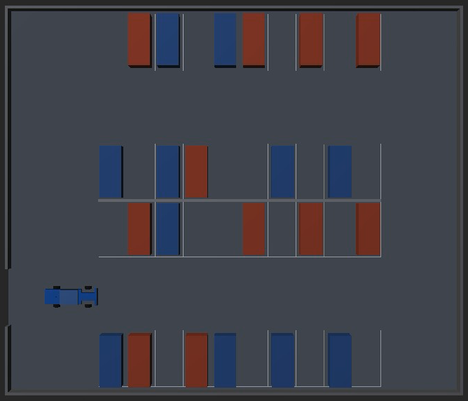

# System Overview

This section shows how the four modules form one agent: what each layer does, what passes between them, and the conventions they share. Sections 5 to 8 then describe each module in detail.

## Layers and modules

Each layer of the agent is one module, owned by one member of the group.

| Module | Layer | What it does | Runs |
|---|---|---|---|
| M1 – World and Sensors | Sensing | The Webots lot and car; turns the lidar scan into free bays and obstacles | Every step |
| M2 – Route Planner | Deliberative | Chooses a bay; plans a drivable route to a pose beside it; replans when the lot changes | Once, then on change |
| M3 – Parking Manoeuvres | Procedural and reflexive | State machine for the reverse park; brakes when a gap is too small | Every step |
| M4 – Control and Results | Control | Steers along the route and holds the speed | Every step |

```
        lidar scan, GPS, compass
                  |
   M1  sensing    |   free bays, new obstacles
                  v
   M2  DELIBERATIVE   choose a bay -> Hybrid A* route to the pre-park pose
                  |                         ^
                  v                         |  stop on the route -> replan
   M3  PROCEDURAL     DRIVE -> ALIGN -> PARK -> DONE
       REFLEXIVE      brake if a gap is under 0.15 m or under the stopping distance
                  |
                  v
   M4  CONTROL        steering and speed commands -> wheel and steering motors
```

The deliberative layer is slow and runs rarely; the layers below it run every control step of 32 ms. This is the split described by Gat's three-layer architecture [3] and by the declarative–procedural–reflexive hierarchy of the syllabus.

## One control step

A single class, `ValetAgent` (`agent/valet_agent.py`), runs the whole loop: `actuation = agent.step(time, pose, speed, lidar_ranges)`. In each step:

1. **Sense.** The lidar scan is turned into the gap between the car body and the nearest obstacle on each of its four sides. Once a second it is also used to update which bays are occupied and where new obstacles are.
2. **Plan, when needed.** If the car has no route, or the once-a-second check finds the chosen bay taken or the route blocked, M2 plans again from the car's current pose.
3. **Decide.** M3's state machine takes the gaps, the pose and whether the route is complete, and returns a command: follow the route, park with a given speed and steering angle, or stop.
4. **Act.** M4 turns that command into a steering angle and a speed, which the Webots controller sends to the motors.

## What passes between modules

| From | To | Data |
|---|---|---|
| M1 | M2 | Occupied bays; obstacles seen by the lidar, as rectangles |
| M1 | M3 | Pose and speed; gaps around the car body |
| M2 | M3 | The chosen bay and its pre-park pose |
| M2 | M4 | The route: poses about 0.25 m apart, each marked forward or reverse |
| M3 | M4 | A command: follow the route, park (speed and steering), or stop |
| M4 | M3 | Whether the route is complete |
| M3 | M2 | An emergency stop on the route, which triggers a new plan |

## Shared conventions

Mismatched conventions between modules are a common source of bugs, so all four modules use the same ones:

- **Frame:** Webots' east–north–up frame, with the origin at the lot's bottom-left corner and units of metres and radians.
- **Pose:** the centre of the car's rear axle, which is also the Webots robot's origin and the GPS position.
- **Heading:** measured anticlockwise from the x-axis.
- **Signs:** a positive steering angle turns left, and a positive speed is forward.

Tests check these at the boundaries. For example, `tests/test_m1_world.py` checks the Webots world against the planner's map of the lot, and `tests/test_m4_control.py` checks the steering signs forward and in reverse.

## Offline and in Webots

The same `ValetAgent` runs in two places:

- **Webots:** `controllers/valet_agent/valet_agent.py` reads the GPS, compass and lidar, and drives the four wheel motors and two steering motors.
- **Offline:** `agent/run_offline.py` simulates the lot, a ray-cast lidar and the car's motion, and runs the agent many times without Webots. It ran the 40-bay test and the scenarios in Section 9.

Only the source of the sensor readings differs, so the code measured offline is the code that runs in Webots. Section 9 compares the two directly.


